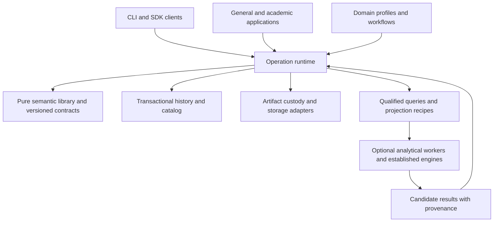

# GR-OS architectural assessment

**Class:** Informative engineering assessment and discussion proposal  
**Status:** PROVISIONAL; recommendations are not adopted decisions or Standards  
**Date:** 2026-10-13 JST

**Subsequent disposition:** This document preserves the initial assessment. The user subsequently selected explicit R8 layering and authorized implementation of Layers 5 and 6 in C++ with Python access, then a stop for review. [ADR-0001](decisions/ADR-0001-layered-development-and-layers-5-6.md) and the [current README](README.md) govern that implementation stage. Statements below about an assessment-only workspace describe the earlier review, not its current contents.

I recommend reconstructing GR as a library-first modular system: a small semantic foundation, one dependable runtime for governed operations, explicit domain profiles, and separate analytical execution. R8 provides a strong account of the concerns that matter. Its proposed language, registries, instruction machinery, and systems runtime are too extensive to make the initial implementation plan.

The immediate architectural problem is the coexistence of two different historical protocols and several interpretations of identity, disclosure, and derived views. Solving those contracts will contribute more to correctness, reuse, and development efficiency than selecting a native language or designing a compiler first.

The new workspace contains documentation only. Existing source, repository configuration, specifications, and retained runtime records were not changed. The [review evidence](REVIEW_EVIDENCE.md) records inspected areas, local revisions, checks, and limitations. The [open decisions](docs/planning/open_questions.md) identify what remains for discussion.

## Existing system and intended objectives

The programme develops ways to record, inspect, contest, reinterpret, and continue generative histories. Its motivation includes the symbolic crisis: provenance and institutional acceptance alone cannot establish that a representation is adequate or true. The infrastructure consequently needs more than artifact storage or a graph of final outputs. It needs inspectable relationships among accounts, their sources, their grounds, their changes, and their uses. This interpretation follows the current [Programme Brief](../PROGRAMME_BRIEF.md), particularly sections 2.0, 3, and 3A.

The existing software has four source repositories and two independent application runtimes:

| Component | Current responsibility | Architectural implication |
|---|---|---|
| Standards programme | Governance drafts, foundation corpus, working requirements, experimental specifications, ADRs | Its authority and release lifecycle remain distinct from software releases |
| Common GSP protocol | Pure Python validation, transaction preparation, record graph and event-time projections | A useful semantic boundary already exists |
| Common Git store | Bare repository per project, accepted revisions, assets, transaction receipts, conditional publication | Several sound guarantees can survive a replacement storage implementation |
| Generalized application | Flask accounts and authorization, protocol HTTP binding, visual records, relations, files and spacetime | Application orchestration still owns important shared behavior |
| Academia native GRRP | Python CLI, scholarly act DAG, content-addressed states, signatures, attribution, disclosure and portable histories | A substantial independent semantic implementation requiring a deliberate crosswalk |
| Academia web application | React interface, Fastify host, SQLite accounts/indexes, Python subprocess writes, TypeScript protocol and read projections | Sharing a deployment tree has not unified its protocol with GSP |

GSP's current package version is 0.3.0, while its base record protocol/schema/profile remain 0.2. Its event-time capability is additive. Its modules are versioned JSON components interpreted by fixed built-ins; they are not an executable plugin system. There is no implemented R8 instruction machine, compiler, heterogeneous execution fabric, or general computational type system.

Academia's native State is scholarly content identified by its bytes. It is not automatically the generalized operational State. A GRRP research transition, a generalized represented Event, a private captured activity, a Git commit, and an external provider response have different meanings. The future common foundation needs to represent their distinctions without requiring different implementations of generic history and transaction mechanics.

Your intended direction is broader than either application: an independently useful foundation and CLI, reusable domain and scientific packages, multiple storage and compute choices, and applications assembled over shared contracts. This is a coherent objective. It does not require every part of the system to share one universal object model or execution engine.

## What the implementation establishes

The generalized path already separates pure preparation from storage publication. It validates a complete candidate graph, supports references among records created in the same transaction, retains first-class n-ary relations, and publishes records, assets, and a receipt through one conditional Git ref update. Retry handling checks actor and request digest before rejecting a stale base. These are valuable acceptance cases for reconstruction. See [core.py](../gr_infrastructure/common/packages/gsp_record_protocol/src/gsp_protocol/core.py), [store.py](../gr_infrastructure/common/packages/gsp_git_store/src/gsp_git_store/store.py), and [protocol_api.py](../gr_infrastructure/gr_generalized_application/web_application/generative_app/protocol_api.py).

The same path also shows the limits of the existing generalization. The schema embeds one profile's roles, enums, module names, and size limits. Revision tokens expose hexadecimal Git-oriented shapes. Queries and mutations repeatedly normalize and validate whole snapshots; project listing loads complete snapshots; history is capped rather than paginated. These are concrete candidates for better interfaces and indexes. They are not measured proof that the language or Git is intrinsically too slow.

The academia audit exposed deeper contract issues:

- **Actor continuity:** a current-source, two-account API probe accepted the second user's claim, but the native performer was the record-local identity, matching the opening question and neither web account. The host authorizes the session but does not pass that actor into the normal native write path. Authentication, acting party, signer, registrar, delegation, and custody need separate explicit contracts.
- **Canonical bytes:** Python and TypeScript accept numeric payloads for which their encodings differ. For example, `1.0` becomes `1.0` in Python and `1` in TypeScript; `1e-7` also differs in exponent spelling. An integer above JavaScript's safe range is rounded on the TypeScript side. Passing existing vectors does not establish agreement over the admitted input space.
- **Projection meaning:** Python counts an objection answered by a responding transformation or decision. The TypeScript read projection marks parents of any act answered. A derived view can duplicate and change semantics even when it never writes authoritative records.
- **Disclosure and custody:** hosted project visibility does not implement the full native per-transition disclosure model. Native key material is held in the filesystem; some older UI/server comments overstate separation from server custody.
- **Publication and recovery:** native GRRP uses several file writes and optional Git commits without the generalized path's common CAS/receipt boundary. Hosted writes also trigger broad index rebuilds. This requires a transaction and recovery design before scaling concurrent use.

These findings favor reconstruction of shared contracts. They do not imply that every existing module is defective or that a full rewrite automatically corrects them. Detailed anchors and test scope appear in [review evidence](REVIEW_EVIDENCE.md).

## Assessment of the handoff

R8's strongest decisions are conceptual: independent semantics, reusable domain applications, separate storage and execution, explicit temporal and epistemic qualifications, safe handling of unfamiliar records, and distinction between an archival format and an execution plan. It also correctly treats general data processing as optional and scientific methods as packages rather than foundational ontology.

R8 already warns against implementing every diagram box. The remaining risk is cumulative complexity: a universal type system, operation algebra, multiple registries, semantic and computational IRs, compiler coordination, two scheduling scales, resource manager, transfer framework, plugin lifecycle, and many storage engines could each be reasonable alone. Together they constitute a substantial language and execution platform before the smallest stable record contract is settled.

I would revise the design in the following ways:

| R8 proposal | Assessment and recommended change |
|---|---|
| Six conceptual layers | Useful as a responsibility checklist. Choose source boundaries and ownership independently; do not implement a six-stage call stack |
| Small universal semantic kernel | Keep a small implementation core, but define a mandatory qualified-history contract. A generic envelope with optional arbitrary JSON would lose the purpose of GR |
| Eight candidate instructions | Use ordinary typed builders, commands, queries, and scoped verification initially. Construction, admission, selection, and analysis have different effects and costs |
| OS-like runtime | Begin with dispatch, authorization, transaction/retry handling, bounded jobs, and diagnostics. Leave fine-grained numerical scheduling to analytical engines |
| General data language and IR | Begin with typed SDK calls and versioned projection recipes. Add a query expression algebra only when real composition and optimization needs justify it |
| Independently extensible registries | Preserve separation of type descriptions, operations, and implementations. Initial registration can be explicit and static; dynamic discovery and elaborate negotiation can follow demonstrated need |
| Universal storage adapter family | Separate transactional history, opaque artifacts, and derived analytical materializations. HDF5, Parquet, Git, and SQL do not offer interchangeable transaction contracts |
| One shared kernel for every domain | Share generic mechanics and public contracts. Allow distinct domain rules, decoder versions, and archival interpretations; integration does not require semantic homogenization |
| No kernel edits for any future extension | Aim for locality for anticipated extension categories. Some future semantics will need a new core contract version; claiming otherwise invites an excessively generic escape hatch |

The runtime is also a potential concentration of responsibility. Calling it systems software does not by itself define a useful boundary. Commit coordination, query execution, GPU scheduling, and external publication have substantially different failure models. A small runtime can coordinate coarse operations while each subsystem owns its native work. That is a stronger boundary than routing every operation through a universal instruction interpreter.

## Recommended design

Use a modular monolith for the initial trusted implementation, with independently usable libraries and a service wrapper when needed. Processes should separate where there is an actual trust, failure, deployment, or resource boundary.

This is an illustrative runtime flow, not an adopted package tree. Core semantics do not import the runtime, stores, domains, numerical engines, or user interfaces. Physical adapters implement narrow interfaces owned at their consumer boundary. Scientific code can also run independently on data outside GR; recording a result uses the same governed admission path as other records.

### Semantic foundation

Start with explicit identity/reference categories, immutable record versions, typed payload descriptors, attributable statements and relationships, temporal qualifiers, artifact references, and versioned validation. Keep the distinction between a represented subject and an account about it. Two equal content digests do not identify the same person, event, or institution. A claim that two identities coincide can itself be attributed and contested.

Provide a mandatory qualified-history profile with inspectable reference roles, assertion provenance, temporal meaning, revision kind, and diagnostic scope. Domain extensions can add richer schemas. First-class relations and the six operational roles can be realized through profiles and indexes without six universal programming-language subclasses. Their representational capabilities remain required where the profile promises them.

Separate generic envelope parsing, known-profile validation, integrity verification, authorization, and substantive assessments. A useful verification result says which checks passed, failed, were unavailable, or were outside scope. One `valid: true` flag is insufficient.

Avoid making every scalar in a large dataset an individually narrated historical record. A scientific artifact can carry a typed schema, exact or declared logical identity, input selection, mapping, execution provenance, and bounded internal lineage. The numerical package owns its array or mathematical representation. The archive records its role and history.

Foundation support is narrower than a universal computational ontology. Metamodel II describes the six categories as overlapping, with exhaustiveness and metaphysical priority left open (PDF p.2), permits identities and inverses (p.12), and recognizes histories even for reversible composites (p.15). GRE Chapter 5 distinguishes chronological continuity from generative influence (§5.14) and requires reasoned historical revision (§5.20). [GR-200](../standards/GR-200-epistemic-recording/GR-200.tex), E200-027, explicitly permits semantic distinctions without separate software objects. These support a small implementation with strong contracts, not an ontology-free blob store.

### History and qualified queries

Preserve at least three distinguishable histories: changes represented in the world; admission and revision of records; and evolution of interpretations or categories. They need not be three separate databases or one compulsory set of timestamps on every record. GR-110 further distinguishes changes in evidence and judgment from changes in categories, methods, or institutional recognition; preserve these revision kinds rather than flattening them into an undifferentiated update.

A query needs an explicit context: source revision or snapshot, selected assertion set or interpretation policy, temporal basis/cut, profile and projection versions, and the caller's current access context. Historical reproducibility is conditional on continued authorized access and retained inputs. It cannot guarantee that a revoked reader will always recover an old result.

The current event-time profile combines all non-withdrawn order accounts, including contested ones; a cycle prevents its cut/topology. That is faithful to [GR-SPEC-121](../specifications/GR-SPEC-121-event-time-projection/GR-SPEC-121.md), not an implementation bug. Future inquiry should support a declared selection of competing accounts. For example, one witness's chronology and another's can produce separately qualified views while the combined contradictory view remains available. Record exclusions and reasons; do not silently discard edges to produce a convenient DAG. This develops an already [open programme question](../docs/planning/open_questions.md), Q-45.

Cache views by source revision, selection/policy, semantic and reducer versions, and effective access scope. Recheck current authorization before serving historical results. Do not key only by record hash. Hidden relations, counts, missing endpoints, and even content digests can disclose information; preserve a safe partial-view explanation only where its disclosure is authorized.

### Admission runtime and effects

The runtime coordinates command authorization, a pinned read basis, profile validation, complete candidate validation, atomic admission, durable receipts, and recovery. Both CLI and service paths use it. Pure library use remains possible for parsing and verification; it does not grant hosted mutation authority.

Keep preconditions and acceptance rules in the semantic/profile contract. The runtime executes those rules and the storage adapter enforces atomic publication. This avoids two components each assuming the other has checked integrity or authority. Incremental validation can later use a dependency closure, but must preserve complete-candidate guarantees for related records created together.

External actions use durable intent, attempt, and outcome records. A local transaction and a provider call cannot be treated as one ordinary database transaction. Persist an outbox request, use provider-supported idempotency where available, and preserve uncertain outcomes for reconciliation. A timeout can mean the remote action succeeded without its response reaching us. Do not promise universal exactly-once effects.

Start long-running execution with bounded jobs, deadlines, cancellation, progress, and explicit result admission. Do not build an instruction scheduler for small immutable record operations. Cancellation after a commit cannot erase the commit; a job must report which boundary it crossed. Recheck permissions when a delayed job starts, reads restricted input, exports, or publishes a result, as appropriate to its authorization contract.

### Storage and recovery

My initial storage candidate is one transactional authority for accepted record versions, history membership, catalog metadata, authorization state where appropriate, and receipts, plus an artifact store for large or preserved byte sequences. SQL is a reasonable first implementation. Avoid requiring every state to be reconstructed by replaying historical commands through current code.

For a local deployment, evaluate SQLite first. It has a concrete single-writer constraint; WAL allows concurrent readers and a writer and requires same-host access. It is not a blanket answer for multi-host or heavily concurrent institutional writes. A hosted SQL implementation can follow requirements and measurement. These constraints are documented by [SQLite](https://www.sqlite.org/wal.html).

Store authoritative accepted versions or complete admitted changes with sufficient content to recover history. Derived indexes are rebuildable; account/authority data and custody metadata are not automatically disposable. A materialized view is legitimate when its source and reducer version are explicit and it cannot silently replace its inputs.

The SQL-plus-artifacts proposal introduces a real recovery obligation. Before publishing a record reference, durably stage and verify its referenced bytes under the chosen store's guarantees. Commit the reference and receipt at one defined acceptance point. Failed prepublication writes can leave orphan artifacts; garbage collection needs a safe reachability/retention policy. Use an inspectable, versioned artifact-reference inventory or conservatively retain dependencies when an opaque payload prevents safe reachability analysis. Backups must contain a matching accepted database state and its artifact closure. Within the declared failure and durability model, faults between these steps must not produce a reported successful commit with unavailable required content. This protocol deserves tests rather than a generic `StoragePort` promise.

Separate three interfaces: transactional history, artifact custody, and analytical materialization. Add format-specific readers/writers for arrays or columnar data without pretending those formats implement record admission. Git can remain a legacy/archive or optional history adapter. Adopting SQL as an authority deliberately departs from native GRRP's plain-file-authority rule C11; preserve portable verifiable export and decide that departure explicitly.

Retention is also a design decision. Append-only admission does not settle restriction, redaction, deletion, backup expiry, or the continued disclosure of hashes and metadata. Avoid placing sensitive content irrevocably inside a universal immutable ledger before choosing those contracts.

### Extension and computational interfaces

Separate declarative schemas from executable validators and operations. Inspecting an archive must not automatically load code. Preserve original bytes for an unknown payload where permitted, label validation scope accurately, and refuse operations dependent on unavailable mandatory semantics.

Start with explicit trusted package registration. Add a domain schema, an analytical operation, and an alternative implementation as separate extension exercises. Do not require one ABI to serve schema definitions, numerical kernels, browser views, and external connectors. Trusted native code can be in process; a subprocess alone is not a security sandbox. Untrusted workers need enforced filesystem, network, credential, and resource restrictions.

For computation, expose authorized datasets and versioned mappings through typed APIs. Existing columnar and array ecosystems can handle much of the representation and execution work. Arrow's C data interface already defines a small interchange boundary with explicit lifetime handling; it can reduce cross-language copying where layouts and ownership permit. GR still needs its own qualification, access, and mapping contract around that data. See the [Arrow interface specification](https://arrow.apache.org/docs/format/CDataInterface.html).

Add a serializable projection recipe only for operations whose meaning and replay requirements are understood. Separate recipe identity, result identity, and physical execution details. A future query algebra or compiler can optimize those recipes when there are enough real workloads to define valid rewrites. A compiler is not needed to inspect, record, or verify a simple local history.

Storage and execution remain independently extensible, but not every combination needs to work. An executor advertises the operations and representations it supports, and rejects incompatible requests. Numeric approximation is an operation-specific contract; it cannot relax exact reference identity, signature verification, access checks, or historical selection.

### Language and source organization

Choose one production semantic implementation initially. Bindings and clients can share it; a small independent verifier or reference subset can test interoperability without requiring two complete production engines. Differential tests should include independently designed cases, not only vectors generated by the implementation being checked.

My tentative preference for a portable native record/runtime core is Rust, if a standalone executable and native library are immediate requirements and maintainers can support the toolchain. Python is a credible first production choice if semantic iteration and scientific integration dominate and a Python runtime is acceptable. C++ is justified when existing native integration, team expertise, or measured kernels warrant its additional ownership and ABI discipline. None of those choices establishes high performance by itself, and no comparative benchmark was run in this review.

Keep numerical methods primarily in their natural ecosystems. A Python scientific package need not acquire a C++ or Rust twin. TypeScript should initially be a typed client and UI, with any browser-side verification constrained by an explicit conformance scope.

Develop the new implementation in one workspace with package boundaries and shared compatibility fixtures. Independent releases need not require independent repositories from day one. Preserve the original repository histories and notices. The existing submodule rename and stale npm links are evidence that source topology has operational cost; they are not justification for discarding provenance. Whether `GR-OS` becomes a separately initialized repository remains an open decision.

## Performance and development efficiency

The current generalized profile is capped at 1,000 records, and its store has explicit snapshot and attachment bounds. Academia currently performs broad filesystem scans and rebuilds. The handoff's large columnar and GPU scenarios are future workloads, not demonstrated current demands.

Prioritize measures that remove whole-system work from ordinary operations: indexed metadata, paginated history, snapshot handles, batched reads, incremental projection updates, bounded output, and dependency-aware validation. Preserve the generalized store's existing batch reads rather than replacing them with per-record round trips. Profile before selecting a native rewrite or accelerator.

Before implementation decisions become durable, define a small workload matrix:

| Workload | Correctness and performance evidence to collect later |
|---|---|
| Small local create and historical read | Startup and p50/p95 latency, durable result, no browser/service dependency |
| Growing related record collection | Admission cost, affected-reference validation, query latency, memory, bounded pagination |
| Long history with competing chronologies | Same qualified results before/after indexing; explicit contradiction and selection behavior |
| Two or more concurrent writers | No lost accepted update, deterministic conflict, receipt recovery after timeout |
| Large scientific artifact and analysis | Bytes read/copied, memory peak, transfer and compute time separately, provenance retained |
| Interrupted admission, indexing, and export | Recovery to a declared state, no invalid success, consistent backup/export closure |
| Restricted historical query and delayed job | No unauthorized data through views/caches; revocation behavior defined |

Use current bounded examples for baselines and larger synthetic examples for proposed scale. Test exact semantic operations exactly; give eligible numerical algorithms explicit error and reproducibility profiles. Add GPU or distributed execution only when useful work exceeds scheduling and data-transfer costs under real measurements.

## Alternatives worth considering

| Approach | Advantages | Main cost or risk | When I would choose it |
|---|---|---|---|
| Evolutionary extraction around existing Python packages | Fastest reuse of known behavior; gradual application transition | Legacy profile/storage assumptions can become permanent; two protocols may persist indefinitely | Existing active use makes simultaneous change costly, or early delivery dominates |
| New compact core with legacy readers | Clean ownership, one future admission path, independent CLI, deliberate compatibility | Requires new contracts, storage recovery, mapping, and cutover work | Best default for this reconstruction, with acceptance-driven increments |
| Graph-centered knowledge store with history and policy services | Strong relational querying and flexible vocabulary | Qualified claims, n-ary incidence, temporal interpretation, custody, and atomicity still require explicit design | Knowledge exchange and graph inquiry dominate the first use cases |
| R8 language and execution platform | Rich composable operations, backend optimization and user-defined computational methods | Largest maintenance burden; type/effect/IR/optimizer semantics become a product of their own | Repeated workloads demonstrate that existing engines and typed APIs cannot meet needs economically |

A clean break with read-only archives is also possible as a migration policy. It reduces compatibility machinery but cannot be chosen merely because the code is experimental: the value and obligations of retained records, signatures, identities, and disclosures still matter. Conversely, a new core does not require rewriting every UI at once. Thin adapters can let an existing client exercise the new foundation while legacy records stay clearly labeled.

## Deliberate treatment of existing functionality

| Existing asset or behavior | Recommended disposition for discussion |
|---|---|
| Generalized relation and temporal fixtures | Preserve as versioned compatibility cases; extend for selected competing accounts |
| GSP transaction preparation and atomic receipt behavior | Reuse or reimplement against a clarified runtime contract |
| Git revisions, records, material, receipts | Preserve and map explicitly; do not treat receipt summaries as a replayable event log |
| Native GRRP originals, state bytes, transition skeletons, registrations | Retain versioned verification and original identifiers; translations get distinct identity and provenance |
| GRRP contribution, absorption, branching, disclosure and release semantics | Maintain as explicit academia-profile behavior or record a justified change |
| Actor/signing custody behavior and inconsistent projections | Correct through new contracts and discriminating tests; do not reproduce defects as compatibility requirements |
| Existing APIs, frameworks, source nesting, UI implementation | Freely replace when it simplifies the supported product, with intentional functional coverage |
| Standards and historical ADRs | Preserve; propose new operationalization and any supersession separately |

For each migrated object, retain the legacy protocol/version, original identity, original covered bytes or complete verifiable source, source revision, transformation version, destination identity, and mapping outcome. Exact, qualified, lossy, unsupported, and unresolved are different outcomes. Importing an original alongside a typed view is often more honest than manufacturing an allegedly equivalent native record.

In particular, GSP receipts contain summaries rather than all replacement values, so history cannot be recovered from receipts alone. Preserve snapshots and their revision mapping. GRRP signatures cover selected fields and registration inputs; a translated record does not inherit those signatures' scope. RFC 8785 is a specific encoding contract, not a synonym for any sorted JSON encoding; its number handling also needs an explicit profile. See [RFC 8785](https://www.rfc-editor.org/rfc/rfc8785.html).

## Decisions before implementation

The most consequential decisions are listed in [the open-decision register](docs/planning/open_questions.md). I would resolve them in this order:

1. **First operating context and workload:** standalone local use, hosted collaboration, offline browser editing, and expected collection sizes lead to different engineering priorities.
2. **Minimum semantic contract:** identify what must remain inspectable without a domain package; define first-class relations, claims, identity categories, revision kinds, and mandatory qualifications.
3. **Legacy promises:** choose verification-only preservation, typed views, native conversion, or continuing old-protocol writes separately for GSP and GRRP families.
4. **Actor and custody model:** connect account authorization to acting identity and signing/delegation without equating them.
5. **Canonical value and signature model:** define admissible numbers, encoding versions, signature coverage, unknown payloads, and the limits of logical equivalence.
6. **Admission and temporal query model:** define snapshot scope, concurrency, receipts, selected accounts, partial orders, and reproducibility under revision.
7. **Protection and retention:** define policy enforcement across historical reads, materializations, jobs and exports, including restriction/deletion behavior.
8. **First persistence and execution boundaries:** select one transaction authority, artifact custody protocol, and simplest sufficient job model.
9. **Language, packaging, and repository lifecycle:** decide native independence, bindings, supported platforms, and maintainer/toolchain constraints.
10. **Extension scope:** identify concrete extension examples for the first release and defer machinery without a demonstrated consumer.

These do not need a complete formal theory of every future case. They need enough precision to prevent irreversible format, authority, or custody mistakes in the first implementation.

## Proposed next stage after discussion

Once implementation is requested, test the design with one complete slice: create an attributed account and n-ary relation; admit them atomically through CLI and API; add a retrospective and contested temporal account; inspect earlier and selected present views; preserve an unknown payload; import one GSP and one GRRP example with original verification; enforce current access; export and verify the result. Include two distinct acting parties and recovery after an uncertain commit response.

Then add one academic workflow and one reusable analytical method against the same interfaces. An explicit failed or partial legacy mapping is a valid diagnostic outcome; silently claiming equivalence is not. A second backend or independent verifier should challenge the first contract before it is declared stable, without requiring all proposed storage and hardware families in the first release.

This sequence leaves room for extensive reconstruction while making each new abstraction answer to a complete user operation, a preservation obligation, or measured computational work.
