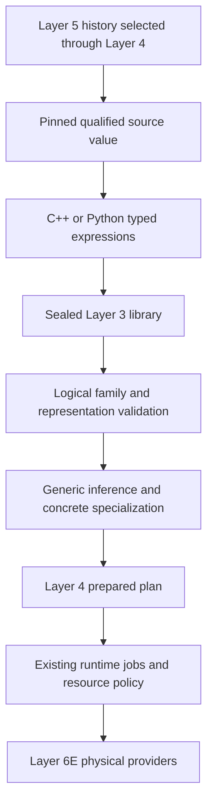

# Layer 3 computational language

Class: experimental implementation contract. Version: GR-OS 0.6. See the [v0.6 assessment](reviews/v0.6-assessment-and-plan.md), [ADR-0006](../decisions/ADR-0006-layer3-maturation.md), original [ADR-0005](../decisions/ADR-0005-extensible-computational-language.md), [data values](data-values.md), and [qualified relational processing](relational-data.md).

Layer 3 describes typed computations over heterogeneous values. It is independently usable through C++ and Python; it does not require an academic project, scientific model, record ontology, database, or application server.

## Five distinct descriptions

| Description | Owner / example |
|---|---|
| Logical or mathematical type | Registered exact family plus child types and parameters; matrix of int64 |
| Semantic admissibility | Family and operator contracts; dimensions, nullable status, checked overflow, preserved qualifications |
| Computational representation | Independent binding; canonical CSR, column buffers, qualified incidence bytes |
| Physical layout | Buffer views, dtype/endianness, offsets/strides, owners, validity bytes, storage/device domain |
| Persistent representation | Explicit serializer/storage contract; not inferred from an in-memory layout |

`Type` is structural, while each family name has exact nominal version identity. `ValueSpec` pairs a logical type with a representation. `DataValue` pairs that specification with an immutable kernel carrier and bounded provenance metadata. No type is identified with a buffer, and there is no universal array/record base class. A third-party mathematical structure can install a family, a representation validator and operators without changing kernel switches.

Traits are inspectable claims. They are not executable rewrite permissions. Version strings do not imply subtyping, coercion, semver compatibility or equivalence between two representations. Conversions must be named operators with explicit contracts. Dimensions may be static parameters or dynamic validated payload properties; the initial table/CSR modules use dynamic extents, avoiding specialization for every row count.

Logical type trees are bounded to depth 32, 4096 nodes and 256 immediate arguments, with the existing 1 MiB canonical metadata limit. Each library allows up to 4096 families, representations and operators. These are inspectable implementation limits, not claims about the extent of possible mathematics.

## Registration, specialization and trust

Build a `Library`, install modules, then `seal()` it before constructing expressions. The seal is permanent. Programs and expressions retain their library and callbacks. Family validators, representation predicates/validators, inference and specialization are trusted pure thread-safe native callbacks; JSON descriptors neither install code nor prove its behavior. Native extensions share process authority. Dynamic loading/unloading and Python callback operators are outside this version.

A family validates the type after its children have been validated. A representation checks whether the type is supported, then validates the actual carrier mapping. Kernel payload tags are transport placeholders before binding; the compiler assigns a concrete bound type ID after checking the logical specification. Physical providers return payloads, and their adapters assign output tags before Layer 4 independently validates all outputs. An arbitrary tag never overrides the representation validator.

An `Operator` declares meaning, effect, determinism, qualifications and native inference/specialization. Inference runs at expression construction and validates all output specifications. Specialization supplies numerical/precondition/invariant contracts and one or more physical providers. The compiler fills concrete signatures and pins the exact recursively expanded family descriptions, representations and operator attributes. Generated operation/provider IDs are deterministic hashes of their bound descriptions. Descriptor fingerprints identify declared contracts; changing executable behavior without changing its declared version is a defective extension, not detectable proof equivalence.

The compiler creates a fresh sealed runtime catalog per program, with standard CPU backends and any explicitly registered additional backend. It does not reopen a live catalog. Provider base IDs can be requested through `CallOptions.selection`; compilation exposes the generated concrete IDs. An unavailable explicit provider fails. Exact lowered operation IDs remain the runtime policy boundary; logical names do not silently authorize all future specializations. Non-thread-safe providers are also serialized across programs from the same library and logical provider identity; separate library instances remain separate extension contexts.

## Lazy composition and compilation

`literal(library, value)` validates and retains immutable payload ownership and copies qualifications immediately. `input(library, name, spec)` declares a template input. `call` supports multiple outputs; `apply` requires exactly one. Mixed library contexts fail explicitly. Use materialization plus explicit import to cross contexts.

`compile(roots, bindings)` visits only reachable expressions, checks exact named bindings and rejects unused binding names. Explicitly shared `Expr` nodes lower once. Distinct but equivalent expressions remain distinct: physical buffer hashes are not a universal logical equality rule. There is no automatic constant folding, reassociation, fusion, cast insertion or structural common-subexpression elimination. Representation checks may reuse exact immutable validation evidence as described below; sharing never grants an unchecked value admissibility.

Named bindings freeze values into the prepared plan. Rebind the expression template to another chunk to create another program; run a prepared program repeatedly when its inputs are unchanged. This gives bounded incremental processing under caller control. It is not continuous streaming, external mutable runtime parameters, backpressure or automatic checkpoint/restart.

`Function(roots)` collects exact named-input specifications and rejects conflicting
uses of one name. `bind(bindings)` produces an ordinary `Program`.
`instantiate({name: expression})` substitutes expressions from the same sealed
library, preserving shared nodes, multiple outputs and provider choices. This
allows another package to compose a reusable computation without implementing an
executor. There are no hidden captures of mutable input values. Function inspection
is bounded to 65,536 reachable frontend nodes; compilation still applies its
configured lower runtime limits. Descriptions are introspection, not executable
serialization or a closure-distribution protocol.

Each immutable call node resolves its trusted specialization once, synchronizing
concurrent preparations. Failed specialization callbacks may retry; successful
specializations are copied into each independently sealed concrete catalog. Inputs,
attributes, inferred outputs and library descriptors cannot change underneath this
reuse. New bindings still pin actual payloads/provenance and produce ordinary plan
identities. This is neither a global specialization cache nor reuse across libraries.

## Bounded immutable validation reuse

`Library(ValidationCacheLimits)` defaults to 64 entries and a conservative 16 MiB
charge. The memo key combines a weak immutable payload-owner token, exact logical
specification/representation and transport tag within that library. Weak control
blocks prevent address-reuse hits without extending payload or buffer-budget
lifetimes. Equal bytes copied into a new owner are validated again. A different
specification, tag or library is a different check; failed checks are never cached.
Family/representation admissibility and bounded provenance metadata remain checked
on every public `validate(DataValue)` call.

Only successful pure representation validation and immutable payload-size checks
are reused. Trusted validators must not depend on mutable external state or claim
that time-sensitive access permission is part of this certificate. Runtime policy,
input/output byte limits, operation-specific checks, cancellation, result identity
and publication remain independent enforcement boundaries.

The charge counts source retained bytes plus serialized specification/tag bytes;
the source is not actually retained by this memo. This bounds the cached workload
and metadata conservatively, not process RSS or allocator overhead. Expired owners
are pruned; LRU eviction and zero entry/byte limits affect performance only.
`clear_validation_cache()` removes entries without resetting counters. An in-flight
successful validation may subsequently repopulate the cache.

`validation_statistics()` exposes hits, misses, failures, expirations, evictions,
entries and charge. Optional `profile_timing` measures successful representation
validation/size/charge work with a monotonic clock; it is instrumentation, not
sampled CPU attribution. Concurrent misses may validate independently before one
entry is installed. Qualified-history parsed-state retention has its own separately
bounded session because reusing a parsed object is different from reusing a verdict.

Selected literal/input roots lower to a typed identity provider, so they use ordinary runtime jobs and policy. Logical graph reachability is distinct from Layer 4's rule that every node in a supplied physical graph is validated and executed.

The existing planner controls finite node/edge/literal/plan limits, implementation selection and prepared execution. `CallOptions` sets per-node input/output limits. The scheduler retains its worker pool, job quotas, cancellation/deadlines, failure joining and resource policy. Module allocation budgets bound tracked owned allocations, not total process memory or third-party allocations. Extracted native value aliases are caller-owned outside the scheduler's job admission quota; Python jobs/leases retain their native result owners.

Cancellation is cooperative. A non-thread-safe provider waiting for the library's
serialization mutex cannot observe cancellation until the active invocation
releases it. Validation and inference callbacks also have no stop-token interface.
Deadlines therefore do not guarantee an upper wall-clock latency for arbitrary
trusted extensions. This limitation predates the validation memo and Function API.

## Results and provenance

A `Program` exposes its ordinary `PreparedPlan`, output specifications and inspectable recipe. Submit its plan with the existing `Runtime`; `Program::materialize` checks successful status, matching plan ID, arity and bound output types before attaching the recipe. Native `JobResult` is a trusted in-process object; these checks do not authenticate a forged C++ result structure. The SDK materializes the retained native job result, not caller-supplied JSON diagnostics.

The recipe ID is pinned in the runtime's optional bounded graph context. Two equal payloads with different source provenance therefore produce distinct plan identities; their results cannot be cross-materialized under another recipe. This additive Layer 4 field was introduced after a review exposed that provenance-only changes would otherwise be invisible to physical plan identity. Empty context preserves prior plan identities. The compiler also checks the complete future provenance envelope before dispatch, so a recipe near the metadata limit cannot execute successfully only to fail when its result envelope is attached.

Each output currently owns a copy of its bounded lineage metadata. Compilation additionally caps the sum of those serialized envelopes at `PlannerLimits.max_plan_bytes` (64 MiB by default), separately from the runtime's plan charge. Large fan-out cannot multiply a near-limit recipe into unbounded output metadata before this check. These serialized limits do not estimate JSON allocator overhead or total RSS. A future shared immutable lineage store can reduce duplication without changing mathematical meaning.

The recipe includes input physical content identities, source provenance, exact logical operations/attributes, qualifications, selected roots and concrete bindings. Physical content identities identify recorded payload/layout and are not representation-independent mathematical equality. An output's recipe describes the requested multi-output program, including its other selected roots. It does not claim every root is a dependency of that particular output.

Derived provenance is computational lineage. It neither asserts that source accounts are true nor automatically publishes a new historical/institutional fact. A caller explicitly chooses serialization, attribution, policy and transaction publication. Provenance/recipes remain bounded metadata; arbitrarily recursive provenance packages or an executable replay archive are not provided.

Historical source values retain complete qualified wrappers, direct archived referents, recording context and selected semantic/physical revisions in a separate bounded bytes carrier. A derived incidence or count is a computational view of that selected source. Event order is selected represented chronology, never physical commit order. See the [relational contract](relational-data.md) for exact losses and exclusions.

## Numerical and interoperability limits

The original standard arithmetic remains checked int64 with explicit null and
prefix/reduction order. The optional v0.6 numeric module adds checked uint64 and
qualified finite binary64/complex128 machine arithmetic under its own operation
profiles. Its fixed rounded machine results are not exact real-number mathematics.
Unsupported environments fail explicitly; there is no implicit promotion, tolerance
acceptance or reassociation. The current runtime still executes only pure/exact
contracts. Registering an approximate/effectful description does not make it executable.

NumPy copy-in and read-only view-out are concrete interop paths over owned host buffers. The caller's mutable array is not retained as an immutable literal. Noncontiguous/endian conversion or missingness handling requires explicit adaptation. NumPy arrays do not intrinsically carry the framework's null validity or historical qualifications.

Arrow's schemas, validity bitmaps, nested validity and ownership callbacks are not equivalent to naming some buffers. SciPy CSR's duplicate consolidation can change checked integer traversal semantics. DLPack exchange additionally needs device, stream and capsule lifetime rules, and does not create immutability. These ecosystems are future adapters rather than dependencies of the logical type universe. Primary references: [NumPy buffer views](https://numpy.org/doc/stable/reference/generated/numpy.frombuffer.html), [Arrow columnar layout](https://arrow.apache.org/docs/format/Columnar.html), [Arrow C interface](https://arrow.apache.org/docs/format/CDataInterface.html), [SciPy CSR](https://docs.scipy.org/doc/scipy/reference/generated/scipy.sparse.csr_array.html), [DLPack Python specification](https://dmlc.github.io/dlpack/latest/python_spec.html).

## Next engineering priorities

Measure specialization/validation/transport separately from prepared execution.
v0.6 adds bounded owner-based validation reuse and per-node specialization reuse;
global content caches and algebraic fusion remain deferred. The independent package
tests establish a source-build boundary, not a universal native plugin ABI. Before
broad Layer 2 tooling, select approximate domains/reference policies, reusable runtime
parameters or stream/backpressure needs, executable package provenance and portable
recipe/source custody. Only a small composed consumer tests the next-layer boundary;
no application or legacy migration is included.
