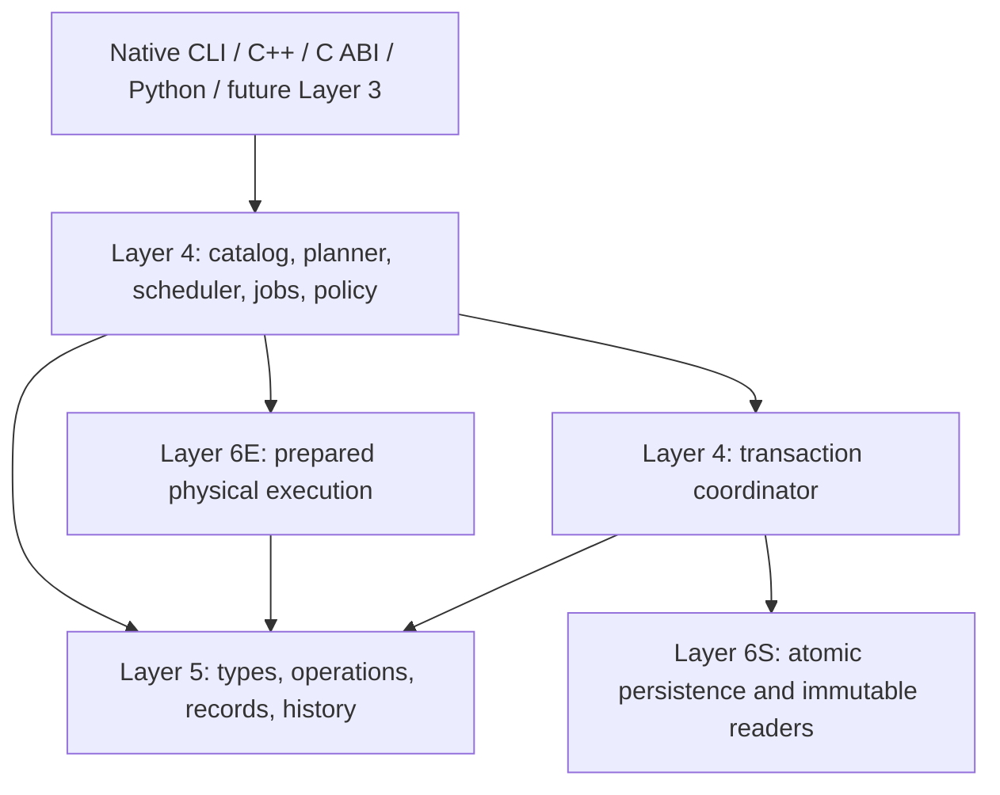

# Layer 4 GR Systems Runtime

**Class:** Implementation architecture specification  
**Status:** EXPERIMENTAL, v0.4 foundation refinement; not an adopted Standard

Layer 4 is an independently usable native execution and transaction environment.
It owns prepared plans, bounded asynchronous jobs, execution policy, and semantic
publication. It does not define a programming language, scientific method, or
application ontology. The [assessment prepared before implementation](reviews/layer-4-assessment-and-plan.md)
and [ADR-0003](../decisions/ADR-0003-prepared-runtime-and-atomic-publication.md)
record the alternatives and selected scope.

The [v0.4 assessment](reviews/v0.4-assessment-and-plan.md) and
[ADR-0004](../decisions/ADR-0004-compact-history-admission-and-owned-buffers.md)
extend this foundation with compact history, transaction-local validation reuse,
optional serialized writer admission, owned typed buffers and numerical declarations.
A separate experimental Layer 3 consumer exercises these contracts without making
a data language or domain ontology part of the runtime.

## Responsibilities and dependency direction

| Subsystem | Owner and interface | Implemented behavior |
|---|---|---|
| Meaning | L5 type/operation registries | Versioned types, arity and result types, exact determinism, effects, descriptor pins, trusted pre/postconditions |
| Physical implementation | L6E implementation registry and `ExecutionBackend` | Independent providers, backend/target capabilities, prepared invocation, CPU execution |
| Module catalog | L4 `Catalog` | Explicit trusted registration, exact module dependencies, frozen capability descriptions and sealed lifetime |
| Compiler/planner | L4 `Planner`, `PreparedPlan` | Whole-DAG validation, type/effect checking, compatible deterministic provider selection, preparation, bounded cache |
| Jobs and resources | L4 `Runtime`, `Job` | Fixed worker pool, dependencies, priority aging, per-job serial mode, cancellation, deadlines, admission and retained-payload budgets |
| Semantic transaction | L4 `TransactionCoordinator`, `Transaction` | Pinned base, bounded staging, L5 admission, artifact closure, optional history manifest, explicit recovery |
| Persistence | L6S `IStore` | One-workspace atomic publication, immutable versions/blobs, expected-head CAS, receipts and backend-specific durability |
| Access | C ABI 1, Python SDK, `gr` executable | Shared native semantics; process-local owned handles; machine-readable requests/results |

The improvement over v0.2 is substantive: repeated runtime descriptor preparation
has a reusable fast path; graph scheduling and asynchronous lifetime have a native
owner; whole-candidate admission moves out of the C binding; semantic-history
custody and record publication can share an atomic storage transaction. L6S remains
independent of GR record semantics. Existing direct L5 and L6 APIs remain useful.

## Execution model

The initial IR is a typed DAG with literal operands, result references and explicit
control dependencies. Compilation validates every node, including nodes whose
results are not exported, before a provider callback runs. The plan selects exact
compatible semantic/provider/backend/target contracts and pins their lifetime.
No speculative algebraic rewriting, dead-code elimination or numerical relaxation
is performed. A bounded cache avoids repeated planning of identical graphs.

Preparation is native ahead-of-execution planning, not native machine-code AOT
compilation or JIT. It preserves a useful future compiler boundary without adding
an unneeded bytecode ISA. MLIR dialects or LLVM code generation can later produce
compatible plans/providers under explicit effect and numerical contracts. See
[planning and extension contracts](runtime-planner.md).

The scheduler executes ready nodes concurrently within a fixed CPU-slot budget.
An operation remains one semantic instruction even when its provider changes.
Prepared CPU calls run directly on runtime workers; no nested L6 worker pool is
created. Failures cancel unscheduled work, request cooperative stopping, and wait
for active siblings. A completed graph can then enter one publication barrier.
Small latency-sensitive native clients can use prepared invocation directly;
asynchronous scheduling intentionally has additional control and tracing cost.

## Transaction model

A publishing job captures its private transaction base at admission. Pure
computation happens outside any database write transaction. Only after the whole
graph succeeds does the runtime materialize declared artifact outputs, validate
the complete candidate, and request one short L6 commit. The caller explicitly
supplies attribution and a permitted workspace. Registration itself grants no
publication permission.

The atomic unit is one workspace on one selected backend: record versions, current
membership, uploaded/required objects, optional semantic-history artifact/manifest,
head update and receipt. L5 consistency checks and physical storage integrity
checks have separate owners. Isolation is a pinned immutable view plus optimistic
whole-workspace CAS; unrelated edits can conflict. Memory is volatile. SQLite uses
native WAL/FULL synchronization with filesystem/device qualifications.

A semantic history bundle can contain branches and explicit merges while its
physical publication ledger remains linear. They do not become the same history.
The coordinator retains prior semantic nodes and checks complete artifact custody.
Complete bundles/checkpoints have explicit size and accumulated storage costs.

An error after entering storage publication can mean `outcome_unknown`. Recovery
checks the stable transaction receipt and exact request identity. Frozen retry does
not rerun computation or rebase changes. Missing receipt observation is not proof
of rollback; successful acknowledged publication wins late cancellation. See the
[transaction contract](runtime-transactions.md) for the exact state machine,
crash-test scope and limitations.

## Resource, trust and lifetime boundaries

Admission reserves live-job slots and runtime/result-owned retained logical
payload. The plan/cache and transaction snapshot/staging have separate bounds.
These are not a universal process heap limit. Concurrent callback temporaries,
metadata, backend snapshots, Python copies and native aliases extracted from a
result are outside the retained-job quota. C++ values share immutable payloads;
the Python execution transport currently copies JSON/base64 data.

Jobs and exported native results keep admission leases until released; cleanup of
the final internal worker reference can be briefly asynchronous. Plans retain
prepared code/backend objects. Shutdown stops admission, requests cancellation and
joins active workers; it cannot forcibly preempt a trusted blocking callback.
Runtime instances have independent pools/budgets. Host applications must coordinate
multiple runtimes and externally threaded providers to avoid oversubscription.

Policy restricts operation names and workspace publication inside this runtime.
It is neither principal authentication nor protection from arbitrary native code.
All registered validators/providers are trusted in-process code. There is no
dynamic native plugin ABI, safe unload, code sandbox or external-effect worker.
See [scheduler contracts](runtime-scheduler.md) and [SDK/CLI contracts](runtime-sdk.md).

## Deliberately deferred mechanisms

| Candidate | Reason for deferral and required next contract |
|---|---|
| Work stealing / TBB / OpenMP internal parallelism | Measure queue contention first; coordinate nested team capacity and cancellation through resource leases |
| Numerical arrays / SIMD / GPU / NUMA | Define shape/layout, ownership, residency, transfers, alignment, numerical equivalence and device completion before enabling target classes |
| Compiler passes / MLIR / JIT | Define transformation obligations, pass/version provenance, cost evidence and code lifetime; arbitrary rewrite registration is not a correctness proof |
| Dynamic plugins | Decide native ABI, distribution, provenance, trust/isolation and unload rules; explicit static registration is implemented |
| Per-record transaction concurrency | Define read/write sets and predicate conflicts; current whole-workspace CAS is simple and conservative |
| Cross-store artifacts / outbox | Atomic manifest/outbox in one authority plus immutable staging and idempotent reconciliation; eventual convergence is not distributed ACID |
| Durable job recovery / remote execution | Persist intent, execution/validator identities, leases and idempotency; process-local job handles do not survive restart |
| Incremental history / garbage collection | Preserve historical custody, unknown interpretations and retained provenance under a deliberate compatibility/retention decision |

## Readiness for the next layer

The implemented vertical slice supports a bounded Layer 3 prototype consuming
typed exact host values: plan a DAG, select a provider, execute asynchronously,
apply limits/cancellation, and publish computed artifacts with validated records
and history through C++ or Python. The native CLI exercises the same mechanism.
The [verification record](verification.md) states what was actually tested and
[benchmark protocols](../benchmarks/README.md) state what was measured.

Another focused Layer 4 increment is recommended before broad Layer 3 development
or claims of a general HPC language or production multi-user platform. Fixed-work
transaction measurements show declining throughput with additional writers and
substantial complete-history processing costs. Highest priorities are a representative array
workload and buffer contract, incremental history/performance targets, service
authentication and access boundaries when required, durable job/recovery intent,
and Linux/platform qualification. No Layer 3 implementation or legacy migration
is included in this increment. Stop here for architectural review.
