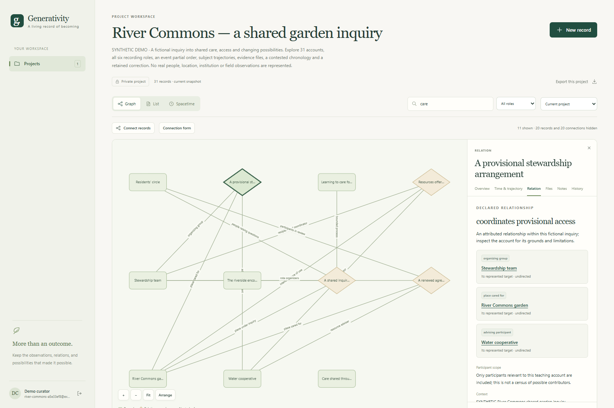
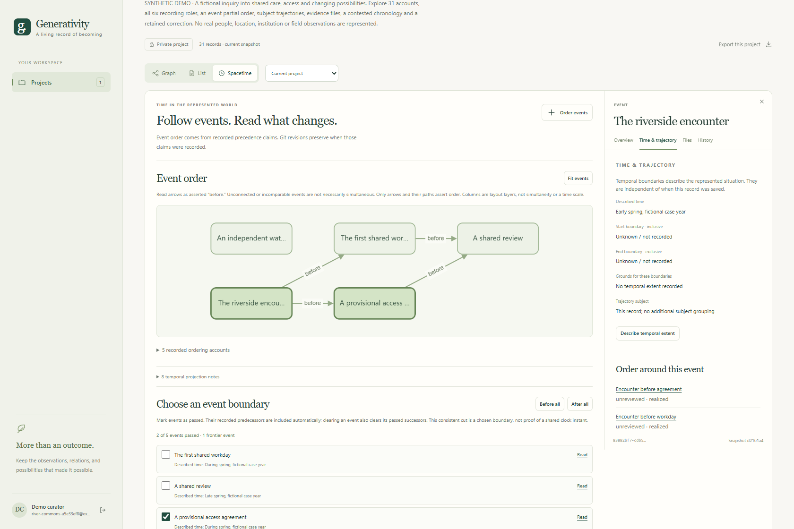
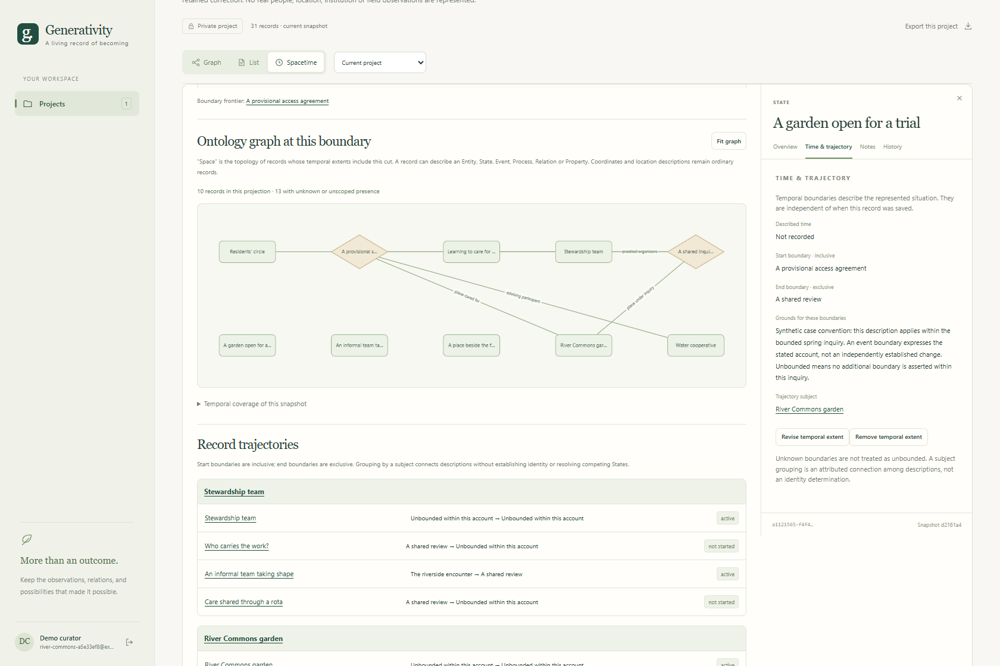
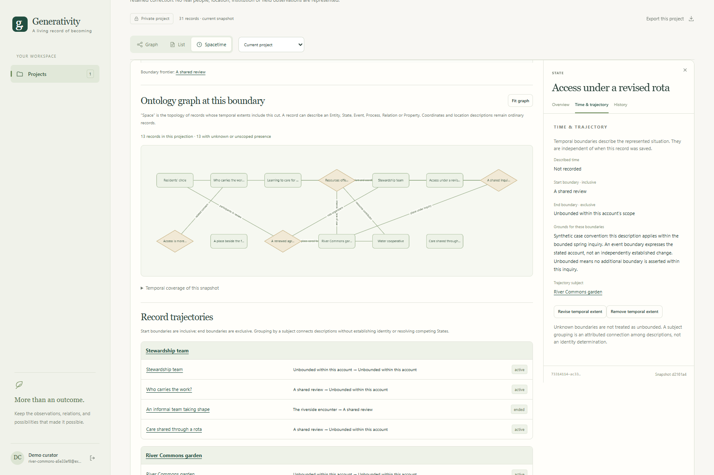
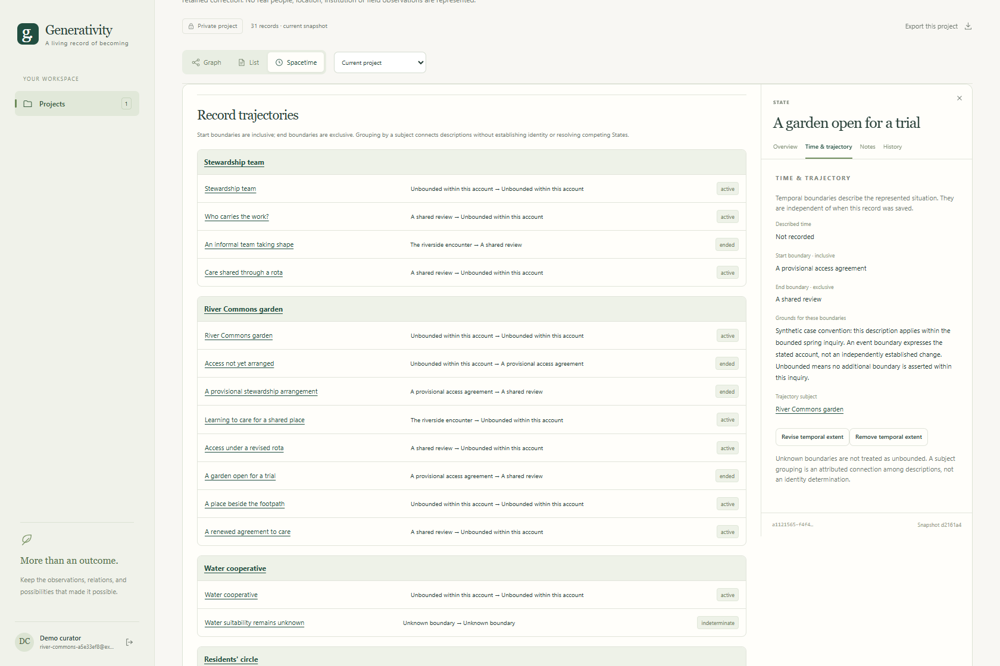

# Generativity Standards Program

**Status:** Preliminary standards programme and experimental applications; no adopted technical Standards.  
**Start here:** [Programme Brief](PROGRAMME_BRIEF.md) · [Development plan](docs/planning/comprehensive_development_plan.md) · [Application setup](applicative_infrastructure/README.md)

**Source repository:** [Generativity-Epistemic-Infrastructure](https://github.com/huangwanhong-maker/Generativity-Epistemic-Infrastructure)

The Generativity Standards Program develops epistemic and practical infrastructure for recognizing, recording, examining, contesting and revising claims about reality and its generative trajectories. Its concern includes the conditions, encounters, relations, judgments, alternatives and changes in possibility through which an outcome becomes possible.

The programme responds to **symbolic crisis**: instability in the connections among representations, their referents, institutional classifications and practical trust. A traceable record can help people inspect a claim and its grounds. Provenance, technical validity and institutional acceptance remain distinct from the truth of that claim.

This repository brings together the theoretical source corpus, development procedures, working drafts, specifications, review evidence and an application infrastructure maintained through nested Git submodules.

## What is being developed

| Area | Current work |
|---|---|
| Standards-development governance | Charter, directives, committee arrangements, ethics and contribution rights, review, maintenance and decision procedures |
| Recording and presentation | Operational records, relations, generative trajectories, provenance, uncertainty, revision, protection and presentation |
| Epistemic and institutional practice | Evidence, interpretation, contestation, judgment, jurisprudential interfaces, governance and policy options |
| Technical infrastructure | Experimental information model, transaction protocol, Git storage, modules, schemas and executable verification |
| Applications | A generalized visual record workspace and an independent academia application |

The conceptual architecture distinguishes the deep metamodel of **constraint, change, structure and difference** from the operational record roles **Entity, State, Event, Process, Relation and Property**. These roles support recording; they do not exhaust GR theory or describe ultimate constituents of reality. Ontological, epistemic, normative, legal, institutional, political-economy and implementation concerns retain their different kinds of authority. See the [multilayer architecture](docs/framework/multilayer_architecture.md) and [foundation traceability map](docs/planning/foundation_traceability.md).

## Publication status and reading guide

The [publication package](publications/README.md) contains nine developed TeX working drafts at version 0.3, with prior editions retained. Governance adoption, actual appointments and formal technical work-item approval remain pending. The [review dossier](docs/reviews/validation_0.2/README.md) records substantive findings, synthetic assessments and remaining evidence gaps.

| Publication or source | Read it for |
|---|---|
| [Programme Brief](PROGRAMME_BRIEF.md) | Motivation, scope, authority and development process |
| [Foundation manuscripts](foundation_manuscripts/MANIFEST.md) | GR terminology, conceptual history and source interpretation |
| [Governance](governance/) | Proposed procedures for developing and maintaining the programme |
| [Working-draft package](publications/README.md) | Charter, Directives, GR/TC 1 charter, ethics/IP, GR-100/110/200/210 |
| [Standards-track projects](standards/) | Draft requirements, including GR-120/130/140/160 and further planned projects |
| [Specifications](specifications/) | Implementable experimental models and protocols, particularly GR-SPEC-120/121/130 |
| [Manuals](manuals/) and [technical reports](technical_reports/) | Practical guidance, theory, comparison and experimental semantics |
| [Policy proposals](policy_proposals/) | Recommendatory institutional and public-policy options |
| [Planning](docs/planning/) and [open questions](docs/planning/open_questions.md) | Dependencies, priorities and unresolved decisions |
| [ADRs](decisions/), [reviews](docs/reviews/) and [changelog](CHANGELOG.md) | Decisions, evidence and development history |

A **Specification** can contain precise technical requirements without being an adopted **Standard**. A **Policy / Institutional Proposal** recommends choices and does not itself define technical conformance. The [publication taxonomy](docs/framework/publication_taxonomy.md) explains these boundaries.

The working sequence is **Standard Working Draft → infrastructure need → Specification → pilot → feedback to Standard**. The [comparative study](docs/planning/standards_development_comparison.md) and [drafting models](docs/references/drafting_models.md) examine ISO/IEC, IEEE, ITU and UN practices without claiming affiliation or adoption of those organizations' authority.

## Repository layers

~~~text
generativity_standards_program/             Git repository: programme and canonical publications
├── governance/  standards/  specifications/
├── foundation_manuscripts/  publications/
├── manuals/  technical_reports/  policy_proposals/
├── docs/  decisions/  examples/  schemas/  templates/  tools/
└── applicative_infrastructure/             Git submodule: shared implementation and operations
    ├── common/                            Tracked by the infrastructure repository
    │   ├── packages/gsp_record_protocol/
    │   ├── packages/gsp_git_store/
    │   ├── design/  conformance/
    │   └── tools/
    ├── gr_generalized_application/         Git submodule: generalized application
    ├── gr_academia_application/            Git submodule: academia application
    └── .runtime/                          Ignored private data and local environments
~~~

These are four source repositories with independent histories. The programme pins an infrastructure commit; that infrastructure commit pins one commit from each application. Shared packages belong to the infrastructure repository. Canonical standards and manuscripts remain in the programme repository.

| Repository | Hosted source |
|---|---|
| Programme | [Generativity-Epistemic-Infrastructure](https://github.com/huangwanhong-maker/Generativity-Epistemic-Infrastructure) |
| Infrastructure | [Generativity-Relational-Epistemic-Applicative-Infrastructure](https://github.com/huangwanhong-maker/Generativity-Relational-Epistemic-Applicative-Infrastructure) |
| Generalized application | [Generalized-Generativity-Relational-Social-Science-Application](https://github.com/huangwanhong-maker/Generalized-Generativity-Relational-Social-Science-Application) |
| Academia application | [Generative-Relational-Academia-Application](https://github.com/huangwanhong-maker/Generative-Relational-Academia-Application) |

The applications also create Git repositories for **user project records** inside their private runtime. Those data repositories have a different purpose and are never application-source submodules.

### Obtain the complete workspace

With GitHub SSH access configured, clone the programme and both levels of submodules:

~~~powershell
git clone --recurse-submodules git@github.com:huangwanhong-maker/Generativity-Epistemic-Infrastructure.git generativity_standards_program
cd generativity_standards_program
~~~

For an existing checkout, synchronize the committed submodule URLs and initialize the pinned revisions:

~~~powershell
git submodule sync --recursive
git submodule update --init --recursive
git submodule status --recursive
~~~

The submodule URLs use SSH and require access to all four repositories. The [Git workflow guide](docs/development/git_repository_layers.md) documents the Windows SSH identity setup, remotes and dependency order for publishing. Cloning an application alone obtains its source; the full setup below expects the parent infrastructure layout and shared tools.

### Work across repository boundaries

Make and commit a change in the repository that owns the file. When an application changes, commit it first, then commit its updated submodule reference in infrastructure, then commit the infrastructure reference in this programme. A common-package change starts at infrastructure; a standards-only change stays in this repository. Record architectural decisions and affected publication requirements in the programme alongside implementation changes.

Submodule updates check out the revisions selected by the parent repositories. They do not automatically select a domain application's newest work. Before changing a pin, review the relevant change and its verification evidence. See the [Git workflow guide](docs/development/git_repository_layers.md) for the repository boundaries and maintenance commands.

## Run the applications

Requirements: Python 3.11 or later and Git. Academia additionally requires Node.js and npm; the validated setup uses Node 22, and its current frontend tools require Node 22.12 or later on that release line. Dependency installation needs package-registry access. The generalized interface has no Node build.

From this programme directory:

~~~powershell
python applicative_infrastructure/common/tools/setup_application.py generalized --dev
python applicative_infrastructure/common/tools/setup_application.py academia --dev
~~~

Launch in separate terminals:

~~~powershell
python applicative_infrastructure/common/tools/run_application.py generalized
python applicative_infrastructure/common/tools/run_application.py academia
~~~

| Application | Local address | Current scope |
|---|---|---|
| [Generalized workspace](applicative_infrastructure/gr_generalized_application/README.md) | http://127.0.0.1:8000 | Registration, private projects, record graphs, event-defined spacetime and trajectories, first-class Relations, notes/files, atomic Git transactions, historical views and exports |
| [Generative Relational Academia](applicative_infrastructure/gr_academia_application/README.md) | http://127.0.0.1:8001 | Research projects, question-led trajectories, graph exploration, domain record operations, workspaces and native GRRP tooling |

Use Python 3's local command name where appropriate on Linux/WSL. The [infrastructure guide](applicative_infrastructure/README.md) covers ports, environments, configuration, accounts, backups and independent operation.

The generalized application implements the experimental gsp-record-protocol/0.2 model and gsp.general/0.2 profile. Academia retains native **GRRP v0.1**. Shared account authority, single sign-on and a completed GRRP/general-protocol adapter are not present. Earlier generalized records are converted only through an explicit migration request.

## Application gallery: River Commons

**River Commons** is a comprehensive synthetic demonstration of the generalized workspace: 31 records across all six operational roles, five Events, six retained source files and seven Git revisions. A fictional garden inquiry develops through encounters, provisional access, shared work, competing accounts and later corrections. The later review is recorded before its earlier context, making represented event order visibly distinct from recording order.

### Visualized spacetime

**Space is the ontology topology at a chosen event boundary.** The event partial order above supplies the boundaries; the views below show which scoped records and connections apply. Both use the same preserved Git revision.

**After the provisional access agreement:** two events have passed, and 10 records enter this projection. The trial-access State and provisional stewardship Relation apply.

**After the shared review:** four events have passed, and 13 records enter the projection. Trial accounts end; revised access, a renewed stewardship arrangement and the workload concern apply.

**Follow a subject through these boundaries.** The garden's descriptions progress from **Access not yet arranged** through **A garden open for a trial** to **Access under a revised rota**. The trajectory view retains their explicit event bounds, competing descriptions and uncertainty.

These are selected cuts of a partial order, not equally spaced clock instants. The independent water observation remains unordered; incomparable events are not asserted simultaneous. Choosing a boundary changes the view without creating a Git revision.

The [full ten-image gallery](applicative_infrastructure/gr_generalized_application/docs/gallery/README.md) also shows two temporal cuts of the same revision, subject trajectories, retained files, the upload dialog, a preserved contradiction and a mobile view. The graph overview's visible **care** filter displays 11 of the 31 records; its node positions are arranged for readability. Every account and source material is fictional.

Follow the [demo guide](applicative_infrastructure/gr_generalized_application/web_application/demo/README.md) to create a separate local demo account and project, explore the story, or reproduce the screenshots. Credentials and runtime records stay outside source control. Preview copies are maintained inside this repository so these images also render across Git submodule boundaries on GitHub.

## Verification and publication builds

The [application verification guide](applicative_infrastructure/common/conformance/README.md) gives isolated package, API and browser test commands. The [relocation report](applicative_infrastructure/common/design/migration_verification.md) records **427 passing tests and one platform-specific skip**, production builds and preservation checks from the application migration. These are dated implementation results, not a claim of programme adoption, institutional conformance or production readiness.

The subsequent [spacetime implementation review](docs/reviews/spacetime_projection_2026-09-22.md) records **185 passing tests across focused runs** for the updated generalized/common implementation, including seven browser tests. The [event-spacetime design](docs/planning/event_spacetime_design.md) explains how event-defined cuts select represented topology independently of Git recording order.

To compile the nine working drafts using an installed TeX environment:

~~~powershell
python tools/build_publications.py --wsl Ubuntu-24.04
python tools/check_publications.py
python tools/check_validation_package.py
~~~

The first two commands need the compiler, fonts and Python packages documented in the [publication build guide](publications/README.md). WSL/Linux users can run the build script directly with Python 3. Generated PDFs and reports live in ignored build output; a fresh clone needs compilation before generated-PDF links become available.

## Data, provenance and preservation

Application source, personal runtime data and generated build output have separate lifecycles. Private account databases, sessions, keys, user project repositories, environments and dependency trees are excluded from source control. A source clone does not transfer user accounts or research records. Back up complete runtime directories using the [operation guidance](applicative_infrastructure/README.md#data-and-recovery).

Academia's original source history remains in its repository ancestry and a verified Git bundle with an [import manifest](applicative_infrastructure/gr_academia_application/provenance/README.md). The original checkout remains separate. Historical publications and source notices retain their original wording; later decisions and additional grants are recorded explicitly.

## Contributing

Read [PROGRAMME_BRIEF.md](PROGRAMME_BRIEF.md) and [AGENTS.md](AGENTS.md) before substantive work. Consult foundation manuscripts for GR-specific definitions and preserve disagreements instead of silently reconciling them. Use normative terms deliberately and label unresolved proposals.

For a substantive change, update the affected document, record the issue and alternatives, add or amend an ADR when architecture changes, update [CHANGELOG.md](CHANGELOG.md), and retain unresolved matters in [open questions](docs/planning/open_questions.md). Use the [templates](templates/) for work items, comments and assessment evidence. Implementation checks belong with the repository owning the code; programme decisions and conformance authority remain here.

See [CONTRIBUTORS.md](CONTRIBUTORS.md) for contribution attribution and how to maintain the contributor record.

## License

Project-authored material is available under the [MIT License](LICENSE), with copyright held by its contributors as recorded in [CONTRIBUTORS.md](CONTRIBUTORS.md). The [scope and historical-license notes](LICENSE.md) explain the additional grant, retained historical notices and exclusions. Third-party components keep their own terms; application users' records and uploaded materials are not relicensed merely by being stored in these applications. Each submodule carries its own license and contributor files.
